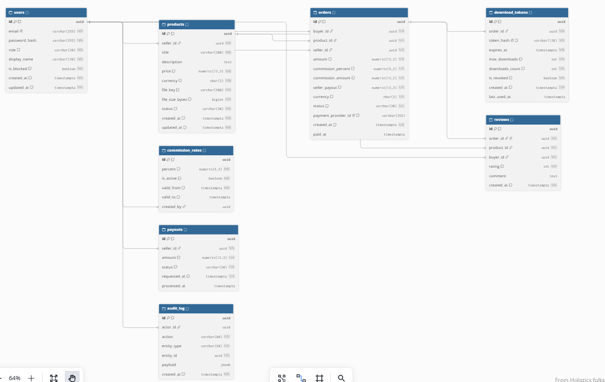

# Digital Goods Marketplace — ARCHITECTURE

## 1. Название и краткое описание проекта

**Digital Goods Marketplace** — платформа (маркетплейс) для продажи цифровых товаров:
электронных книг, шаблонов, курсов, ПО, музыки, графики и т.п.

Продавцы публикуют товары, покупатели приобретают их, а платформа:
- удерживает **комиссию** с каждой продажи (процент настраивается администратором);
- выдаёт покупателю **защищённую одноразовую ссылку на скачивание**
  (TTL + лимит скачиваний, инвалидация после использования);
- ведёт историю заказов, начислений продавцу и аналитику.

**Стек (пример):** React SPA → NestJS/FastAPI API → PostgreSQL, S3/MinIO,
RabbitMQ, Keycloak (JWT).

## 2. Ролевая модель

| Роль | Описание |
|------|----------|
| Покупатель (BUYER) | Просмотр каталога, покупка, скачивание по одноразовой ссылке, отзывы |
| Продавец (SELLER) | Загрузка и управление товарами, статистика продаж, вывод средств |
| Администратор (ADMIN) | Модерация, тарифы комиссии, аналитика, блокировки |

## 3. Основные Use Cases

### Покупатель
- Регистрация / вход.
- Просмотр каталога и карточки товара.
- Оформление и оплата заказа.
- Получение одноразовой защищённой ссылки на скачивание.
- История покупок, повторная выдача ссылки в пределах лимита.
- Оставление отзыва.

### Продавец
- Регистрация как продавец.
- Загрузка цифрового товара (файл + метаданные).
- Редактирование / снятие товара с продажи.
- Просмотр статистики продаж и баланса (за вычетом комиссии).
- Запрос вывода средств.

### Администратор
- Модерация товаров (одобрение / отклонение).
- Управление тарифами комиссии.
- Просмотр аналитики продаж и комиссий.
- Блокировка пользователей и товаров.

## 4. C4 Container Diagram

> Исходник PlantUML — `docs/c4-containers.puml`. Экспорт в PNG/SVG выполняется
> через PlantUML Server или плагин IDE.

**Контейнеры:**
- **Web SPA** — интерфейс покупателя/продавца/админа.
- **API Gateway / Backend** — REST API, бизнес-логика, авторизация.
- **Auth Service** — OIDC/JWT, роли.
- **Order & Payment Service** — заказы, расчёт комиссии, интеграция с платёжным провайдером.
- **Download Service** — генерация одноразовых presigned URL, проверка TTL и лимита скачиваний.
- **PostgreSQL** — основное хранилище.
- **S3/MinIO** — приватное хранение файлов товаров.
- **RabbitMQ/Kafka** — события (`order.created`, `payment.confirmed`, `download.generated`).
- **Analytics Service** — отчёты по продажам и комиссиям.
- **Внешние:** платёжный провайдер (Stripe/ЮKassa), Email-сервис.

**Поток покупки:**
1. Покупатель оформляет заказ → Order Service создаёт запись и инициирует оплату.
2. Платёжный провайдер подтверждает оплату → событие `payment.confirmed`.
3. Download Service генерирует токен (UUID + HMAC), сохраняет хеш в БД с
   `expires_at` и `max_downloads = 1`, формирует presigned URL в S3.
4. Ссылка отправляется покупателю (email + личный кабинет).
5. При переходе токен проверяется, помечается использованным, ссылка
   инвалидируется.

## 5. ER-диаграмма базы данных

> Исходник DBML — `docs/erd.dbml`, рендер через dbdiagram.io.

### Таблицы и связи

| Таблица | Назначение | Ключевые поля |
|---------|-----------|---------------|
| `users` | Пользователи (все роли) | `id` PK, `email` UNIQUE, `role`, `is_blocked` |
| `products` | Цифровые товары | `id` PK, `seller_id` FK→users, `price` CHECK≥0, `file_key`, `status` |
| `commission_rates` | История тарифов комиссии | `id` PK, `percent` CHECK 0..100, `is_active`, `valid_from/to` |
| `orders` | Заказы | `id` PK, `buyer_id` FK, `product_id` FK, `seller_id` FK, `amount`, `commission_percent`, `commission_amount`, `seller_payout`, `status` |
| `download_tokens` | Одноразовые ссылки | `id` PK, `order_id` FK, `token_hash` UNIQUE, `expires_at`, `max_downloads`, `downloads_count`, `is_revoked` |
| `payouts` | Вывод средств продавцом | `id` PK, `seller_id` FK, `amount` CHECK>0, `status` |
| `reviews` | Отзывы | `id` PK, `order_id` FK UNIQUE, `product_id` FK, `rating` CHECK 1..5 |
| `audit_log` | Аудит действий | `id` PK, `actor_id` FK, `action`, `entity_type/id` |

### Связи (кардинальность)
- `users (seller) 1 — N products`
- `users (buyer) 1 — N orders`; `users (seller) 1 — N orders`
- `products 1 — N orders`
- `orders 1 — N download_tokens`
- `orders 1 — 1 reviews`
- `users (seller) 1 — N payouts`
- `commission_rates` — справочник, при создании заказа снимок процента пишется в `orders.commission_percent`

### Ограничения и индексы
- Все PK — `UUID` (`gen_random_uuid()`).
- NOT NULL на всех обязательных полях; UNIQUE: `users.email`, `orders.payment_provider_id`,
  `download_tokens.token_hash`, `reviews.order_id`.
- CHECK: `products.price >= 0`, `commission_rates.percent between 0 and 100`,
  `orders.amount/commission_amount/seller_payout >= 0`, `reviews.rating between 1 and 5`,
  `download_tokens.max_downloads > 0`, `downloads_count >= 0`.
- Индексы: все FK, `users.role`, `products.status`, `orders.status`,
  `orders(seller_id, status)`, `products(status, created_at)`,
  `download_tokens.expires_at`, `audit_log(entity_type, entity_id)`, `audit_log.created_at`.

## 6. Безопасность одноразовых ссылок

- В БД хранится только **SHA-256 хеш** токена; сам токен передаётся в URL один раз.
- Проверка при скачивании: `is_revoked = false AND now() < expires_at AND downloads_count < max_downloads`.
- После успешного скачивания `downloads_count++`; при `downloads_count = max_downloads`
  ссылка становится недействительной.
- Presigned URL в S3 генерируется на короткий TTL (например, 5 минут) — даже при
  утечке ссылки она быстро истекает.
- Все действия с токенами пишутся в `audit_log`.

## 7. REST API Specs

| Метод | URI | Описание | Доступ (роль) | Ожидаемый код |
|---|---|---|---|---|
| **Аутентификация** |
| POST | `/api/v1/auth/login` | Вход в систему и получение JWT-токена | Все | 200 OK |
| POST | `/api/v1/auth/register` | Регистрация нового пользователя | Все | 201 Created |
| **Каталог (Товары)** |
| GET | `/api/v1/products` | Получить список доступных цифровых товаров | Все | 200 OK |
| GET | `/api/v1/products/{id}` | Получить детали конкретного товара | Все | 200 OK |
| POST | `/api/v1/products` | Загрузить новый цифровой товар | Продавец | 201 Created |
| **Заказы и Скачивание** |
| POST | `/api/v1/orders` | Создать заказ на покупку товара | Покупатель | 201 Created |
| GET | `/api/v1/orders` | Список покупок текущего пользователя | Покупатель | 200 OK |
| POST | `/api/v1/orders/{id}/download` | Получить одноразовую ссылку на скачивание | Покупатель (Владелец) | 200 OK |
| **Администрирование** |
| GET | `/api/v1/admin/analytics` | Просмотр аналитики продаж и комиссий | Администратор | 200 OK |